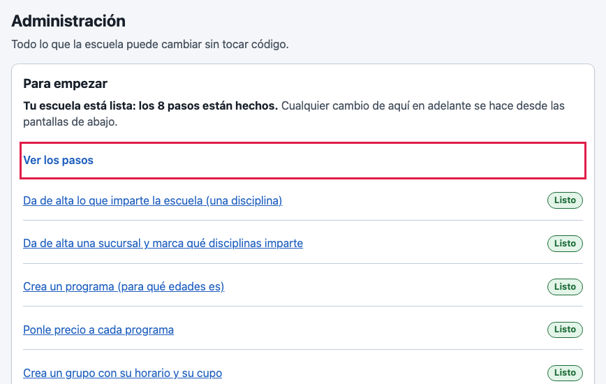
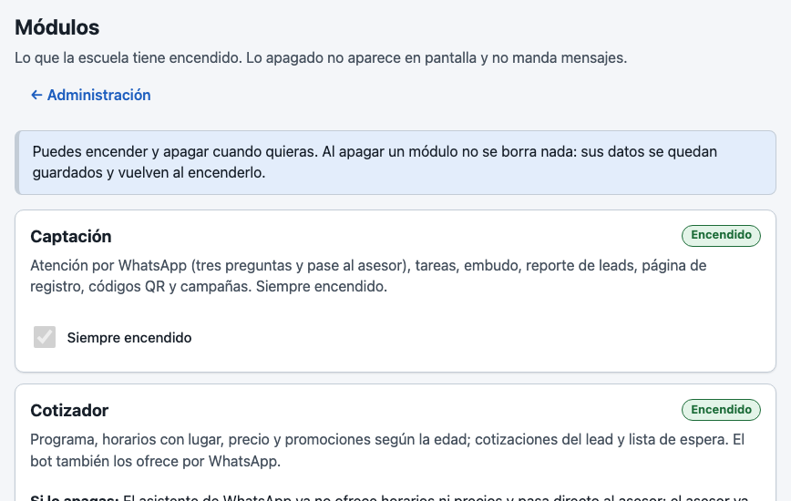
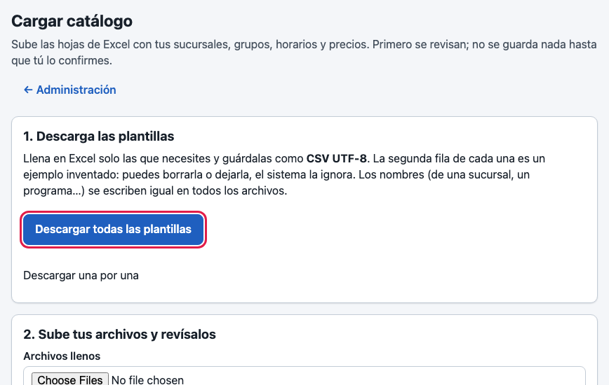
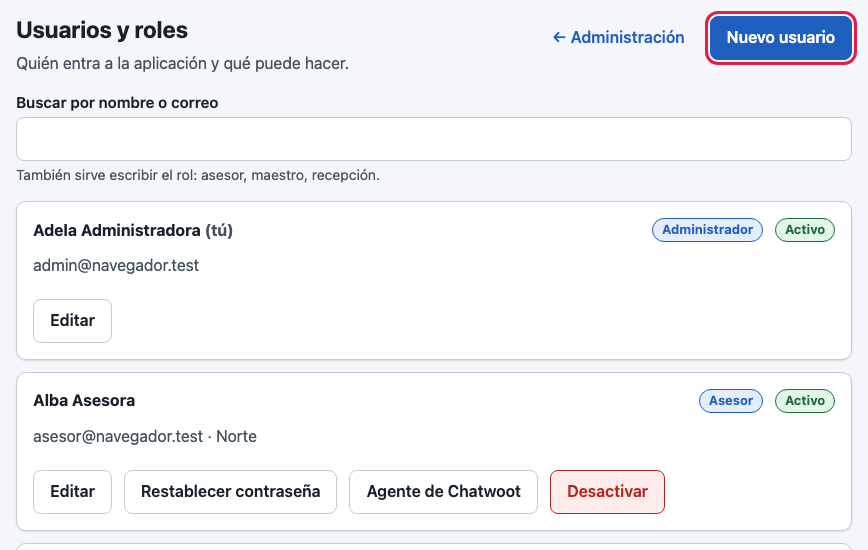
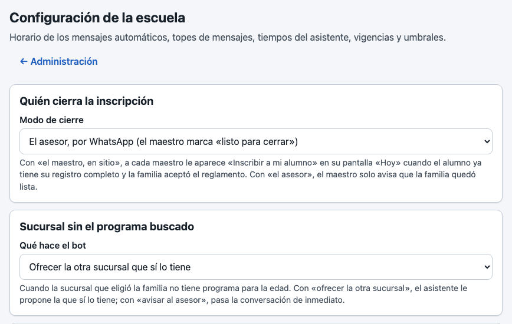
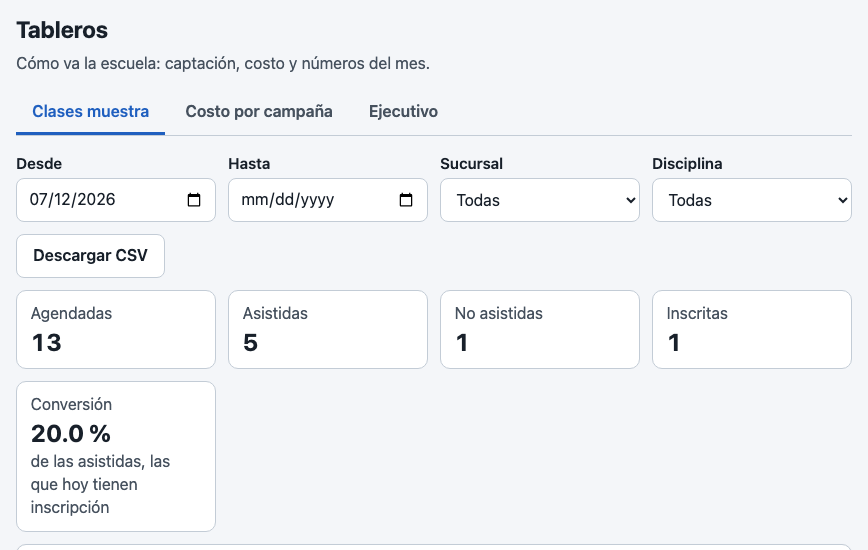

# Guía del administrador

*Para quien nunca ha visto el sistema. Lo que va entre comillas de ángulo, como «Administración», es el nombre exacto de un botón o una pantalla.*

## Para qué sirve «Administración»

Al entrar llegas al «Embudo», como los asesores. Tu trabajo está en «Administración» (en la barra): ahí cambias lo que la escuela puede cambiar sin pedir ayuda. Arriba está «Para empezar» y un buscador, «Buscar una pantalla» (prueba con «precio», «contraseña» o «excel»).

## Primeros pasos, en orden

«Para empezar» lista ocho pasos y los marca solos conforme los haces; «Hacerlo ahora» te lleva al que sigue («Ver los pasos» los despliega):

1. Da de alta lo que imparte la escuela (una disciplina).
2. Da de alta una sucursal y marca qué disciplinas imparte.
3. Crea un programa (para qué edades es).
4. Ponle precio a cada programa.
5. Crea un grupo con su horario y su cupo.
6. Da de alta a las personas que usarán el sistema.
7. Conecta el número de WhatsApp de la escuela.
8. Enciende las partes del sistema que vas a usar.

Los pasos 1 a 5 se pueden hacer de una sola vez desde Excel: «Cargar catálogo». «Descargar todas las plantillas» baja un archivo comprimido: ábrelo, llena las hojas en Excel y guárdalas como CSV UTF-8 (qué pedirle a la escuela para cada hoja: [lista para mandarse](../QUE-PEDIRLE-A-LA-ESCUELA.md)), súbelas y toca «Revisar»: no guarda nada y te dice, por fila y columna, qué corregir. Cuando salga limpia, «Aplicar» y «Sí, aplicar». Subir lo mismo otra vez no duplica nada.

## Tu día en 5 pasos

1. Revisa «Tableros»: «Clases muestra», «Costo por campaña» y «Ejecutivo».
2. «Usuarios y roles»: «Nuevo usuario» (elige el rol; la contraseña se la das en persona), «Restablecer contraseña» o «Desactivar» a quien ya no trabaja aquí. A cada asesor, «Agente de Chatwoot» y «Vincular».
3. Precios: en «Precios» elige el programa y toca «Nueva vigencia»; rige desde la fecha que elijas y no cambia lo ya cobrado. Grupos: «Grupos y horarios», «Nuevo grupo».
4. «Módulos»: la casilla «Encendido» prende o apaga una parte (captación siempre está prendida). Al apagar, confirmas; nada se borra y todo vuelve al encenderlo.
5. «Configuración»: horario de los mensajes automáticos (nunca antes de las 09:00 ni después de las 20:00), tiempos del asistente y «Quién cierra la inscripción» (los textos del asistente van en «Textos del asistente»). Lo que no entiendas, déjalo como está: cada ajuste dice su valor de siempre.

## Si algo sale mal

| Lo que ves | Qué significa y qué hacer |
|---|---|
| “Hay … por corregir. No se guardó nada.” | En «Cargar catálogo»: corrige las filas que dice, vuelve a subir el archivo y a tocar «Revisar». |
| “Para apagarlo, primero apaga…” | Un módulo depende de otros: apágalos en el orden que dice. |
| «No disponible» | Esa parte está apagada: enciéndela en «Módulos». |
| “Siempre debe quedar al menos un administrador activo…” | No puedes desactivarte a ti mismo ni quitarte el rol. |
| “Demasiados intentos. Espera…” | Alguien se equivocó de contraseña 5 veces; se libera solo en unos 15 minutos. |
| «Todavía no hay campañas» | Da de alta la primera en «Campañas y códigos QR». |
| Un grupo o precio mal capturado | Un precio no se edita: captura otro con fecha posterior. Para un grupo, «Editar». |

## A quién avisar

A tu contacto de Grupo CCB cuando algo no se pueda cambiar desde las pantallas (por ejemplo, las claves de WhatsApp o recuperar algo dado de baja), o cuando una pantalla falle. Dile qué hacías y copia el mensaje tal como salió. Lo que sí se puede cambiar, y lo que no, está en el [inventario de configuración](../CONFIGURACION-INVENTARIO.md).
