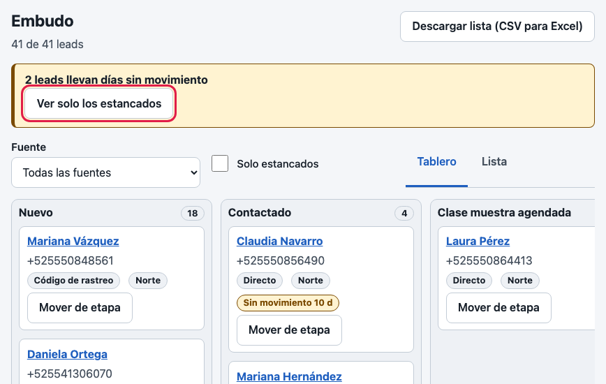
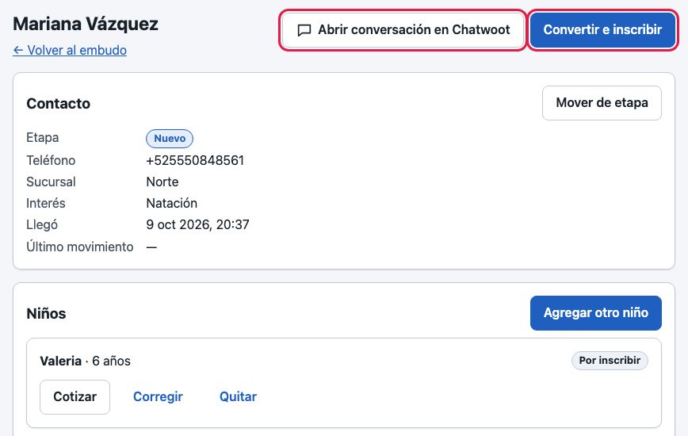
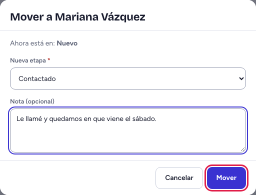
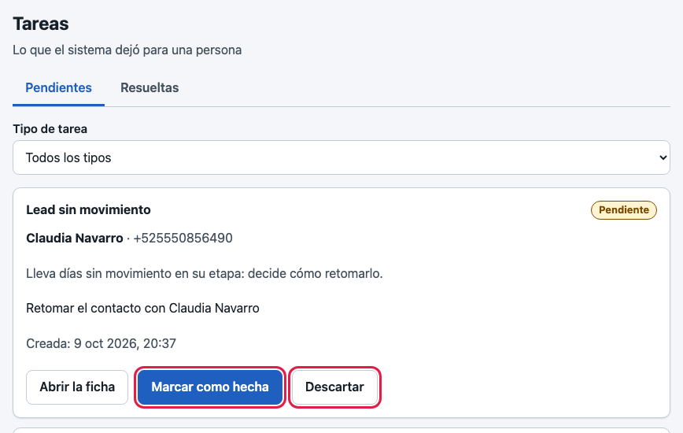
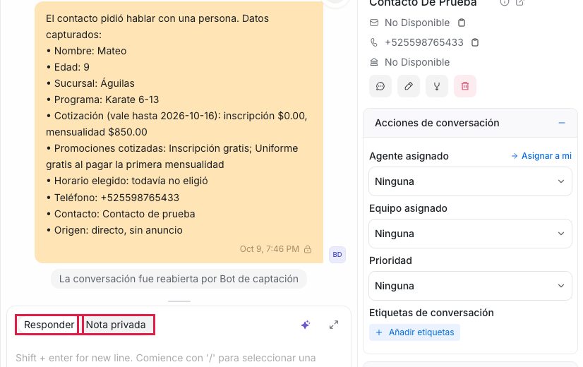
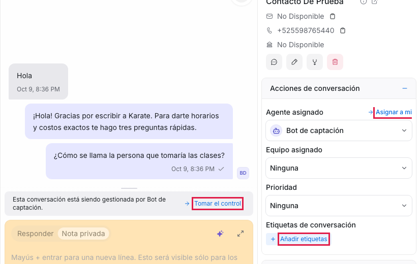

# Guía del asesor

*Para quien nunca ha visto el sistema. Lo que va entre comillas de ángulo, como «Embudo», es el nombre exacto de un botón o una pantalla. Lo que va en negritas es de Chatwoot, la bandeja de WhatsApp.*

## Para qué sirve tu pantalla de inicio

Tu inicio es «Embudo»: cada familia que escribió aparece en una tarjeta, en la columna de su etapa. Es tu lista de trabajo. En la barra también tienes «Tareas»: lo que el sistema te deja pendiente.

## Tu día en 5 pasos

1. En «Embudo», si ves el indicador amarillo «Llevan días sin movimiento», toca «Ver solo estos»: son familias que llevan días sin respuesta. Empieza por ellas.
2. Toca una tarjeta para ver su ficha lateral (o el nombre, para abrirla completa): teléfono, niños, de dónde llegó e historial. Si la familia ya escribió por WhatsApp, ahí aparece «Abrir conversación en Chatwoot».
3. «Cotizar a mano» le calcula el precio; «Agendar clase muestra» le reserva lugar. Si ya decidió, «Convertir e inscribir» abre un asistente de seis pasos que solo pide lo que falta. El cobro lo hace recepción.
4. Anota cada avance con «Mover de etapa»: elige la «Nueva etapa», escribe una nota si quieres y toca «Mover». Si la familia dijo que no, elige la etapa de pérdida y el «Motivo de pérdida».
   Sin la inscripción activada, toca «Marcar como inscrito» y anota cómo fue.
5. Termina en «Tareas»: haz lo que pide cada una y toca «Marcar como hecha» (o «Descartar» si ya no aplica). Qué hacer con cada tipo de tarea viene en el documento [Operación diaria](../OPERACION.md) (pídelo al administrador).

## En Chatwoot

- La conversación se abre en otra pestaña. Entre los mensajes verás una nota de color naranja: el resumen que dejó el asistente (nombre, edad, sucursal, horario elegido, origen). La familia no la ve.
- Para contestarle usa **Responder**; para apuntar algo solo para tu equipo, **Nota privada**.
- Si la familia no te escribió en las últimas 24 horas, WhatsApp no deja mandar un mensaje libre, solo una plantilla aprobada: si Chatwoot no te deja escribirle, es por eso. Si el sistema quería escribirle y no había plantilla que sirviera, no manda nada y te deja la tarea «Sin plantilla apta»: llámale.
- Si ves **Tomar el control** (una barra gris sobre la caja de escribir), el asistente todavía habla con la familia. Al tocarlo (o con **Asignar a mi**, en **Acciones de conversación**) o al escribir cualquier mensaje o nota, el asistente se calla y no manda promociones. Los recordatorios de lo ya acordado (clase muestra, pago) siguen saliendo.
- **Añadir etiquetas** (en **Etiquetas de conversación**) es solo para ti y tu equipo.
- **Resolver** cierra la conversación: hazlo solo cuando no quede nada pendiente. El asistente no vuelve a hablar ahí, y si la familia escribe después, empieza una conversación nueva desde cero.
- Nunca escribas datos de salud en notas ni mensajes. No mandes plantillas de promoción antes de las 9:00 ni después de las 20:00, ni a quien escribió BAJA.

## Si algo sale mal

| Lo que ves | Qué hacer |
|---|---|
| “No se puede abrir la conversación: falta la dirección pública de Chatwoot…” | Chatwoot no está conectado del todo. Avisa al administrador. |
| “El lead cambió mientras lo veías. Cierra esta ventana…” | Alguien más movió a la familia. Ciérralo y revisa su etapa. |
| «Falta la sucursal» | Toca la que acordaste con la familia; después no se cambia. |
| «No disponible» | Esa parte no está activada. Avisa al administrador. |
| Tarea «Mensaje no entregado» | Revisa el teléfono y llámale. |
| “Correo o contraseña incorrectos.” | Revísalos; si sigue, pide que te restablezcan la contraseña. |

## A quién avisar

Al administrador de tu escuela: pantalla que no carga, Chatwoot que no abre, plantilla que falta o tarea que no entiendes. Dile qué hacías y qué mensaje salió.

