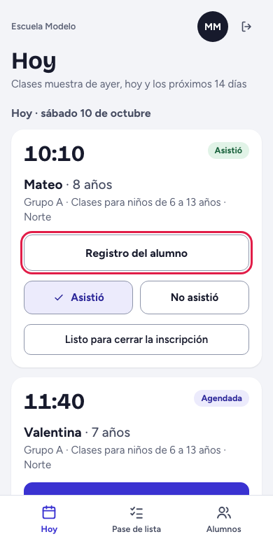
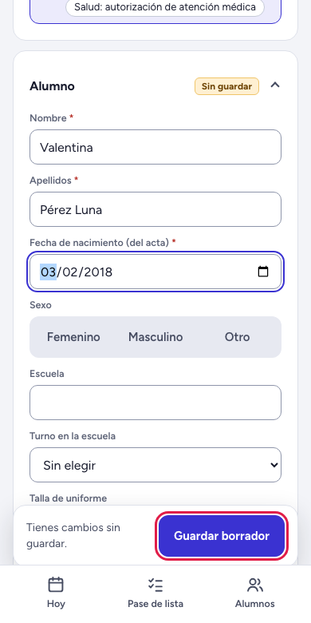
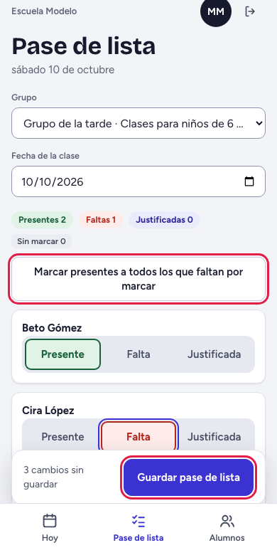
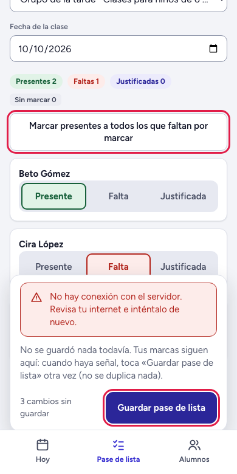

# Guía del maestro

*Pensada para leerse en el celular. Lo que va entre comillas de ángulo, como «Hoy», es el nombre exacto de un botón o una pantalla.*

## Para qué sirve «Hoy»

Es tu pantalla de inicio: las clases muestra de tus grupos de ayer, de hoy y de los próximos 14 días. Desde aquí marcas si el niño vino y abres su registro. Abajo tienes tres botones: «Hoy», «Pase de lista» y «Alumnos».

## Tu día en 5 pasos

1. Entra con tu correo y tu contraseña y toca «Entrar».
2. Cuando llegue el niño de una clase muestra, toca «Asistió». Si no vino, «No asistió». Se marca desde la hora de la clase y, si te equivocas, tocas el otro botón (hasta 48 horas después).
3. Toca «Registro del alumno» y llénalo por secciones; toca el título de cada sección para abrirla; cada una tiene su «Guardar esta sección» y abajo siempre está «Guardar borrador». Antes de salir, mira que diga «Todo guardado.». Pide a la familia que acepte el reglamento y la autorización de imagen: toca «Aceptan» en cada uno (si te pide el «Nombre de quien responde», escríbelo). Al final, «Marcar registro como completo»: el sistema te dice qué falta.
4. Cuando el niño ya asistió y la familia quiere inscribirse, toca «Listo para cerrar la inscripción»: el asesor recibe el aviso. Si ves también «Inscribir a mi alumno», confirma con «Sí, inscribir»; si no lo ves, tu escuela cierra la inscripción por WhatsApp con el asesor.
5. Para pasar lista de tu grupo: «Pase de lista», «Marcar presentes a todos los que faltan por marcar», marca «Falta» a quien no vino (o «Justificada» si avisó) y toca «Guardar pase de lista».

## Qué pasa si no hay señal

No pierdes nada. Si tocas «Guardar pase de lista» sin señal, sale un aviso rojo y tus marcas se quedan en la pantalla. Cuando vuelva la señal, toca el botón otra vez: no se duplica nada. Con «Guardar esta sección» sale “Lo que escribiste sigue aquí”; con «Guardar borrador» no sale aviso, así que confirma que diga «Todo guardado.».

Si sales a media captura (con el enlace de arriba para volver a «Hoy»), al volver verás “Recuperamos lo que habías escrito y todavía no guardaste”. Pero si cierras la página o la recargas, se pierde: guarda antes.

La salud del niño se escribe solo en su sección del registro. Nunca la mandes por WhatsApp ni la anotes en otro lado.

## Si algo sale mal

| Lo que ves | Qué hacer |
|---|---|
| “No hay conexión con el servidor. Revisa tu internet e inténtalo de nuevo.” | Busca señal y toca otra vez el botón que usabas. |
| “Tu sesión terminó. Inicia sesión de nuevo para continuar donde estabas.” | Entra otra vez; lo que tenías escrito sigue ahí. |
| “La clase de ese día todavía no empieza: el pase se toma desde la hora de inicio.” | Espera a la hora de la clase. |
| “Ese día este grupo no da clase. Elige otra fecha.” | Cambia la «Fecha de la clase». |
| “No se encontró lo que buscas…” | Ese alumno no es de tus grupos. Toca «Ir a mi inicio». |
| “Correo o contraseña incorrectos.” | Revísalos; si sigue, pide que te restablezcan la contraseña. |

## A quién avisar

Al administrador de tu escuela: si no te sale una clase, si falta el reglamento (“No hay reglamento ni autorización de imagen vigentes…”) o si no puedes entrar. Dile qué hacías y qué mensaje salió.
