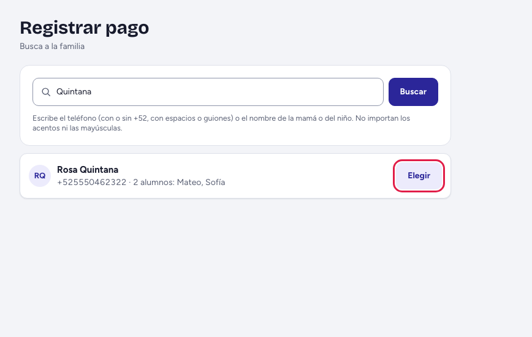
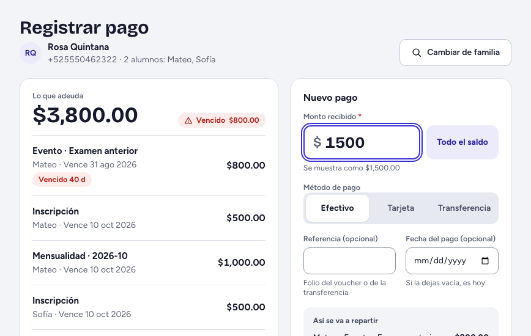
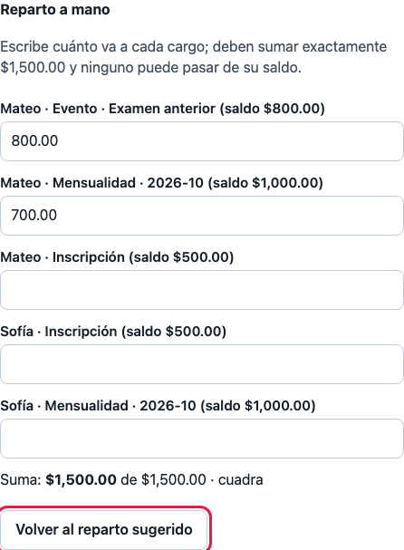
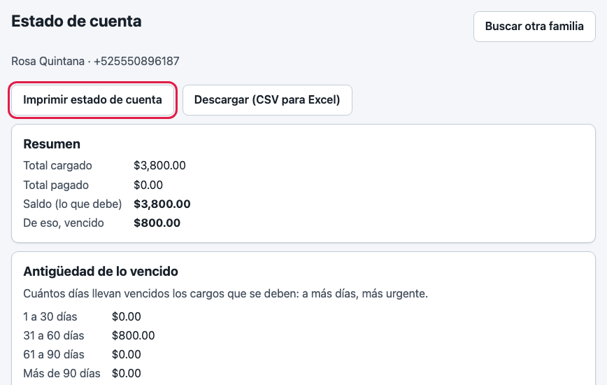
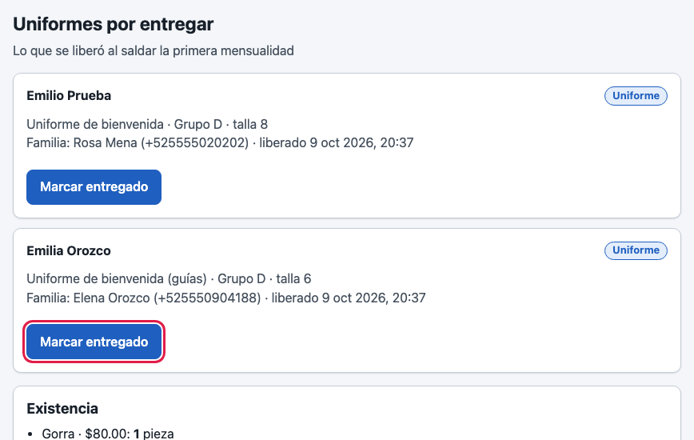
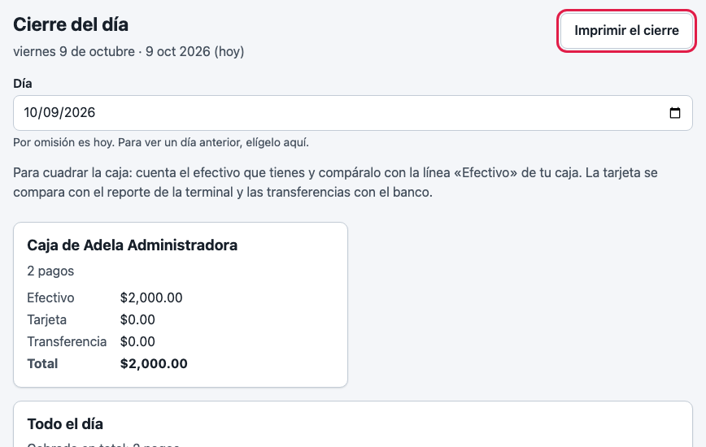

# Guía de recepción

*Una página para quien nunca ha visto el sistema. Lo que va entre comillas de ángulo, como «Registrar pago», es el nombre exacto de un botón o una pantalla.*

## Para qué sirve tu pantalla de inicio

Tu inicio es «Registrar pago»: aquí buscas a la familia, ves lo que debe y cobras. En la barra tienes el resto de tu trabajo: «Estado de cuenta», «Uniformes», «Ventas» y «Cierre del día».

## Tu día en 5 pasos

1. En «Registrar pago» escribe el teléfono o el nombre de la mamá o del niño en «Teléfono o nombre de la familia» y toca «Buscar». En la familia correcta, «Elegir».
2. Verás «Lo que adeuda». Escribe el «Monto recibido» (con punto para los centavos: 1250.50), elige el «Método de pago» y toca «Registrar pago». El sistema reparte el dinero entre los hijos, empezando por lo más antiguo. Luego puedes dar «Imprimir recibo».
3. Si la familia quiere repartirlo distinto entre hermanos, escribe primero el monto; luego toca «Ajustar el reparto a mano» y anota cuánto va a cada cargo: la línea «Suma» debe decir «cuadra»; «Volver al reparto sugerido» regresa. Si cobraste mal, en «Pagos recientes» toca «Cancelar pago», escribe el motivo y confirma con «Cancelar el pago»: no se borra, el saldo regresa.
4. «Estado de cuenta»: busca a la familia y toca «Imprimir» o «Descargar (CSV para Excel)». En «Uniformes», cuando la familia ya pagó su primera mensualidad, toca «Marcar entregado» y confirma en la ventana con «Marcar como entregado». En «Ventas»: busca al alumno con «Buscar», toca el producto, ajusta la cantidad con «−» y «+», «Registrar venta» y luego «Cobrar ahora».
5. Al cerrar, entra a «Cierre del día»: compara la línea «Efectivo» de tu nombre en «Por quien cobró» (cada persona tiene su caja; el cuadro ámbar «Efectivo para contar en caja» suma todas) con el dinero de tu caja (la tarjeta, con el reporte de la terminal; las transferencias, con el banco) y toca «Imprimir cierre».

## Si algo sale mal

| Lo que ves | Qué significa y qué hacer |
|---|---|
| «Ese teléfono no está completo» | Escribe los 10 dígitos, o busca por el nombre. |
| «No encontré a esa familia» | Revisa el teléfono o prueba con otro nombre. |
| «No hay nada que cobrar» | La familia está al corriente. |
| “El pago pasa de lo que la familia adeuda” | Cobra solo lo que debe; no hay saldo a favor. |
| “Escribe un importe válido: los centavos van con punto y a lo más dos decimales…” | Corrige el monto: 1250.50, no 1,250,50. |
| «Este uniforme ya se entregó» | Otra persona lo entregó hace un momento; no hay nada que hacer. |
| “No hay piezas con existencia…” | No hay uniformes de esa talla. Avisa al administrador y entrégalo cuando lleguen. |
| “No hay conexión con el servidor. Revisa tu internet e inténtalo de nuevo.” | Vuelve a tocar «Registrar pago»: si el pago ya había quedado, no se cobra dos veces. |

## A quién avisar

Al administrador de tu escuela: si falta una pieza de inventario, si un cargo está mal, o si una parte de tu barra no aparece (puede estar apagada). Para dudas de un cobro ya hecho, lleva el recibo o el nombre de la familia.
