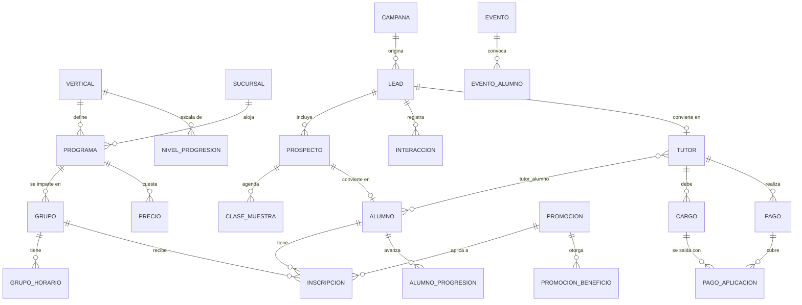

# Modelo de datos — Sistema de leads y alumnos multi-vertical

Escuela con 3 verticales (Karate, Ballet, Baile), N sucursales, embudo desde redes sociales hasta alumno inscrito.

**Principio rector:** todo lo que el cliente pueda querer cambiar (sucursales, programas, precios, promociones, etapas del pipeline, nombres de progresión) vive en tablas, no en código.

---

## 1. Mapa de módulos

```
CONFIGURACIÓN        OFERTA              CRM                 OPERACIÓN
─────────────        ──────              ───                 ─────────
organizacion         programa            lead                inscripcion
vertical             grupo               prospecto           asistencia
sucursal             grupo_horario       interaccion         nivel_progresion
sucursal_vertical    precio              clase_muestra       alumno_progresion
instructor           promocion           etapa_pipeline      evento
                     promocion_beneficio motivo_perdida      evento_alumno
                                         campana
                                                             FINANZAS
                     IDENTIDAD                               ────────
                     ─────────                               cargo
                     tutor                                   pago
                     alumno                                  pago_aplicacion
                     tutor_alumno                            producto / venta
```

---

## 2. Diagrama de relaciones (núcleo)



---

## 3. Configuración y oferta

### vertical
Aquí vive la personalización por disciplina. **No crees tablas separadas por vertical.**

| campo | tipo | nota |
|---|---|---|
| id | uuid | |
| nombre | text | Karate / Ballet / Baile |
| slug | text | para landings públicas |
| etiqueta_progresion | text | "Cinturón" / "Grado" / "Nivel" |
| etiqueta_evento | text | "Examen" / "Recital" / "Showcase" |
| usa_progresion | bool | |
| color_marca, logo_url | text | cada vertical tiene identidad propia |
| activo | bool | |

### sucursal
`id, nombre, direccion, lat, lng, telefono, zona_horaria, activo`

### sucursal_vertical
Tabla puente: qué disciplinas se imparten en cada sucursal. Permite que Ballet exista solo en una sede.
`sucursal_id, vertical_id, activo`

### programa
La unidad que el cotizador consulta.

| campo | tipo | nota |
|---|---|---|
| id | uuid | |
| vertical_id, sucursal_id | fk | |
| nombre | text | "Karate Infantil 4-6" |
| edad_min, edad_max | int | en años |
| fecha_corte_edad | date/null | **clave en ballet**: edad calculada al inicio de ciclo, no a hoy |
| nivel | text | Principiante / Intermedio |
| descripcion_publica | text | lo que ve el lead |
| activo | bool | |

### grupo
`id, programa_id, nombre, instructor_id, salon, cupo_maximo, cupo_ocupado (derivado), permite_lista_espera, activo`

### grupo_horario
Un grupo puede sesionar varios días. Nunca metas los días como texto en `grupo`.
`id, grupo_id, dia_semana (0-6), hora_inicio, hora_fin`

### precio
Versionado por fecha para no perder el histórico de lo que pagó cada alumno.

| campo | nota |
|---|---|
| programa_id | |
| costo_inscripcion, costo_mensualidad | decimal |
| moneda | MXN |
| vigencia_desde, vigencia_hasta | date |

---

## 4. Promociones (motor de reglas)

Este es el módulo que hay que diseñar con más cuidado. Una promo NO es un campo de descuento.

### promocion
| campo | nota |
|---|---|
| id, nombre, codigo | |
| vigencia_desde, vigencia_hasta | |
| aplica_verticales[], aplica_sucursales[], aplica_programas[] | arrays o tablas puente |
| condicion_tipo | `sin_condicion` / `al_pagar_primera_mensualidad` / `min_hermanos` / `pago_anticipado` |
| condicion_valor | jsonb (ej. `{"hermanos": 2}`) |
| cupo_maximo, cupo_usado | int, para promos limitadas |
| acumulable | bool |
| prioridad | int, para resolver conflictos |

### promocion_beneficio
Una promo otorga varios beneficios. "Inscripción gratis + uniforme gratis" son **dos filas**.

| campo | nota |
|---|---|
| promocion_id | |
| tipo | `descuento_inscripcion` / `descuento_mensualidad` / `producto_gratis` / `meses_gratis` |
| modo | `porcentaje` / `monto_fijo` / `total` |
| valor | decimal |
| producto_id | si aplica |
| momento_disparo | `inmediato` / `al_cumplir_condicion` |

### promocion_aplicacion
Auditoría: qué promo se aplicó, a quién, cuándo, quién autorizó, y si el beneficio diferido ya se entregó.
`inscripcion_id, promocion_id, beneficio_id, estatus (pendiente/entregado), fecha_entrega, autorizado_por`

> El caso "uniforme gratis al pagar la primera mensualidad" queda como beneficio **pendiente** hasta que el pago se registre. El sistema debe mostrarle a recepción la lista de uniformes por entregar.

---

## 5. CRM — Leads

### campana
`id, nombre, canal (facebook/instagram/tiktok/google/referido/walk-in), vertical_id, sucursal_id, presupuesto, fecha_inicio, fecha_fin`

### lead
El lead es **el adulto que pregunta**, no el niño.

| campo | nota |
|---|---|
| id, folio | |
| nombre_contacto, telefono, email | |
| campana_id, utm_source, utm_campaign, utm_content | trazabilidad de CAC |
| sucursal_interes_id, vertical_interes_id | |
| etapa_id | fk a etapa_pipeline |
| motivo_perdida_id | null si no está perdido |
| asignado_a (usuario_id) | |
| tutor_id | **null hasta la conversión** |
| creado_en, ultima_interaccion_en | |

### prospecto
Los niños de ese lead. Un lead puede traer 2 o 3 hijos, posiblemente a verticales distintas.

`id, lead_id, nombre, fecha_nacimiento (o edad_declarada), vertical_interes_id, programa_sugerido_id, alumno_id (null hasta conversión)`

### etapa_pipeline
Configurable, con orden y bandera de cierre.
`id, nombre, orden, es_ganado, es_perdido, dias_alerta_sin_movimiento`

Sugerencia inicial:
`Nuevo → Contactado → Clase muestra agendada → Clase muestra asistida → Negociación → Inscrito | Perdido`

### interaccion
`id, lead_id, tipo (whatsapp/llamada/nota/cambio_etapa), contenido, usuario_id, creado_en`

### clase_muestra
La etapa donde más se fuga el negocio. Mídela aparte.
`id, prospecto_id, grupo_id, fecha_hora, estatus (agendada/asistio/no_asistio/reagendada/cancelada), recordatorio_enviado_en, notas`

---

## 6. Identidad — La familia como entidad central

### tutor
`id, nombre, apellidos, telefono, email, rfc, direccion, como_nos_conocio, creado_en`

### alumno
`id, nombre, apellidos, fecha_nacimiento, sexo, alergias, condiciones_medicas, contacto_emergencia, foto_url, autoriza_uso_imagen (bool), estatus (activo/baja/congelado)`

### tutor_alumno
Puente M:N. Un alumno puede tener mamá, papá y abuela registrados.
`tutor_id, alumno_id, parentesco, es_responsable_pago, es_contacto_emergencia, puede_recoger`

> **Esta es la tabla que vale oro.** Permite: un solo estado de cuenta por familia, descuento por hermanos, detectar que la mamá de la niña de ballet tiene un hijo de 7 años (oportunidad de karate), y calcular LTV por familia en vez de por alumno.

### inscripcion
El puente entre alumno y oferta. **Guarda el `lead_id` de origen** — sin eso no puedes calcular costo por alumno inscrito.

| campo | nota |
|---|---|
| id, alumno_id, grupo_id, programa_id | |
| lead_id | origen, para atribución de marketing |
| fecha_inicio, fecha_baja | |
| estatus | activa / congelada / baja |
| motivo_baja | catálogo: económico, cambio_domicilio, horario, insatisfaccion |
| precio_inscripcion_aplicado, precio_mensualidad_aplicado | congelados al inscribir |
| promocion_id | |
| dia_corte_pago | int 1-31 |

---

## 7. Progresión y eventos (genéricos)

### nivel_progresion
Sirve igual para cinturones, grados de ballet y niveles de baile.
`id, vertical_id, nombre, orden, color_hex, horas_minimas, clases_minimas, requisitos_texto`

### alumno_progresion
`id, alumno_id, nivel_id, fecha_obtenido, evento_id, instructor_id, observaciones`

### evento
Cubre examen de cinta, recital de ballet y showcase.
`id, vertical_id, sucursal_id, tipo, nombre, fecha, cuota, cupo, requiere_vestuario`

### evento_alumno
`evento_id, alumno_id, estatus (convocado/confirmado/pagado/asistio), resultado, nivel_otorgado_id`

### asistencia
`id, inscripcion_id, fecha, estatus (presente/falta/justificada), registrado_por, metodo (qr/manual)`

---

## 8. Finanzas

### cargo
`id, tutor_id, alumno_id, inscripcion_id, concepto (inscripcion/mensualidad/evento/producto), periodo (YYYY-MM), monto, descuento, monto_final, fecha_vencimiento, estatus (pendiente/pagado/vencido/cancelado)`

### pago
`id, tutor_id, monto, metodo (efectivo/tarjeta/transferencia/pasarela), referencia, fecha, registrado_por`

### pago_aplicacion
Permite que **un solo pago de la mamá cubra la mensualidad de los dos hijos**.
`pago_id, cargo_id, monto_aplicado`

### producto / venta
`producto: id, vertical_id, nombre (gi, leotardo, zapatillas), talla, precio, stock`
`venta: id, tutor_id, alumno_id, producto_id, cantidad, precio_unitario, es_promocional, promocion_aplicacion_id`

---

## 9. La consulta clave — el cotizador

El corazón del embudo. Entrada: `edad`, `sucursal_id`, `vertical_id`. Salida: horarios + precios + promos.

```sql
SELECT
    p.id AS programa_id,
    p.nombre AS programa,
    g.id AS grupo_id,
    g.nombre AS grupo,
    g.cupo_maximo - COALESCE(ocupados.n, 0) AS lugares_disponibles,
    json_agg(json_build_object(
        'dia', gh.dia_semana,
        'inicio', gh.hora_inicio,
        'fin', gh.hora_fin
    )) AS horarios,
    pr.costo_inscripcion,
    pr.costo_mensualidad
FROM programa p
JOIN grupo g            ON g.programa_id = p.id AND g.activo
JOIN grupo_horario gh   ON gh.grupo_id = g.id
JOIN precio pr          ON pr.programa_id = p.id
                        AND CURRENT_DATE BETWEEN pr.vigencia_desde
                        AND COALESCE(pr.vigencia_hasta, '9999-12-31')
LEFT JOIN LATERAL (
    SELECT COUNT(*) AS n FROM inscripcion i
    WHERE i.grupo_id = g.id AND i.estatus = 'activa'
) ocupados ON TRUE
WHERE p.sucursal_id = :sucursal_id
  AND p.vertical_id = :vertical_id
  AND :edad BETWEEN p.edad_min AND p.edad_max
  AND p.activo
GROUP BY p.id, g.id, ocupados.n, pr.costo_inscripcion, pr.costo_mensualidad
ORDER BY lugares_disponibles DESC;
```

Las promociones aplicables se resuelven en una segunda pasada (filtrando por vertical, sucursal, programa y vigencia), ordenadas por `prioridad`.

---

## 10. La transacción de conversión

Cuando el lead pasa a etapa "Inscrito", en **una sola transacción**:

1. Crear `tutor` desde `lead` (o vincular si el teléfono/email ya existe → detección de familia).
2. Por cada `prospecto`: crear `alumno` + fila en `tutor_alumno`.
3. Crear `inscripcion` con `lead_id`, precio vigente congelado y promoción.
4. Generar `cargo` de inscripción y primera mensualidad.
5. Registrar `promocion_aplicacion` (beneficios inmediatos como entregados, diferidos como pendientes).
6. Actualizar `lead.tutor_id` y `prospecto.alumno_id`.

Cero recaptura de datos. Si el operador tiene que volver a teclear el nombre del niño, el sistema falló.

---

## 11. Índices y detalles que evitan dolor

- Índice único parcial en `tutor(telefono)` normalizado a 10 dígitos → deduplicación de familias.
- Índice en `lead(etapa_id, ultima_interaccion_en)` → tablero de leads estancados.
- Índice en `inscripcion(grupo_id) WHERE estatus='activa'` → cálculo de cupo.
- `soft delete` en todo (`eliminado_en`), nunca `DELETE` físico.
- Bitácora de auditoría en cambios de precio, promoción y baja de alumno.
- Guarda `edad_declarada` del prospecto Y `fecha_nacimiento` del alumno: en el lead el papá dice "como 6", en la inscripción se captura el acta.

---

## 12. Métricas que el modelo ya habilita

- Conversión por etapa, por vertical, por sucursal y por campaña.
- % de leads que agendan clase muestra / % que asisten / % que se inscriben.
- Costo por lead y **costo por alumno inscrito** (vía `campana → lead → inscripcion`).
- Tiempo promedio de cierre.
- Familias con más de un alumno y con más de una vertical (indicador de cross-sell).
- LTV por familia, churn mensual y motivos de baja.
